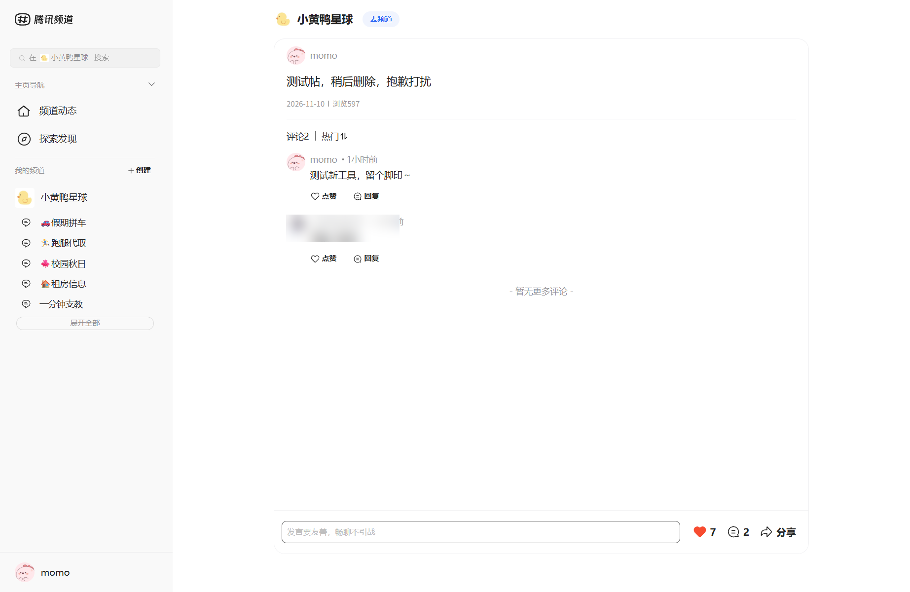

# QQ Channel MCP

> 让 AI 助手像人一样浏览和操作 QQ 频道。
> Let your AI assistant browse and operate QQ Channels like a human.

[中文](#中文) · [English](#english)

---

## 中文

### 这是什么

把 QQ 频道接进 AI 助手（Claude Code 等）。浏览和操作都通过 MCP 工具完成，不是截图转发。

### 功能

**浏览**

| 工具 | 作用 |
|---|---|
| `qq_status` | 登录状态、频道信息、权限 |
| `qq_channels` | 版块列表 |
| `qq_feeds` | 翻帖子（按时间倒序） |
| `qq_comments` | 读评论和回复 |
| `qq_feed_detail` | 单帖详情 |
| `qq_search` | 本地全文搜索 |
| `qq_user_feeds` | 按昵称/ID查某人发帖 |
| `qq_stats` | 发帖/互动统计 |

**操作**

| 工具 | 作用 |
|---|---|
| `qq_like` | 点赞 / 取消点赞 |
| `qq_sync` | 同步帖子到本地库 |
| `qq_profile` | 设置兴趣画像 |

评论、发帖需要通过浏览器自动化完成（详见 [SECURITY.md](SECURITY.md)）。

### 截图



### 安装

```bash
git clone https://github.com/weileyao2005/qq-channel-mcp.git
cd qq-channel-mcp
pip install -r requirements.txt
```

### 配置

1. 复制配置模板：

```bash
cp config.json.example config.json
```

2. 浏览器打开 `pd.qq.com` 并扫码登录

3. F12 → Network → 任意 `pd.qq.com/qunng/...` 请求 → 复制完整 `Cookie`

4. 填入 `config.json`

5. 注册到 Claude Code：

```json
{
  "mcpServers": {
    "qq-channel": {
      "command": "python",
      "args": ["/path/to/server.py"],
      "env": {"PYTHONIOENCODING": "utf-8"}
    }
  }
}
```

### 隐私

- 所有数据存储在本地 SQLite (`feeds.db`)
- 登录凭证仅保存在本地 `config.json`
- 不上传任何数据到第三方
- 项目代码不含任何用户凭证

### 免责声明

本项目为个人自动化工具，基于 QQ 频道网页版接口。接口未公开，可能随时失效。请勿用于刷量、骚扰等用途。账号风险自负。

---

## English

### What is this

Connects QQ Channels to AI assistants (Claude Code, etc.) via MCP. Browsing and operations are done through tools, not screenshot forwarding.

### Features

**Read**

| Tool | Description |
|---|---|
| `qq_status` | Login status, channel info, permissions |
| `qq_channels` | List channels |
| `qq_feeds` | Fetch posts (reverse chronological) |
| `qq_comments` | Read comments and replies |
| `qq_feed_detail` | Post details |
| `qq_search` | Local full-text search |
| `qq_user_feeds` | Posts by a specific user |
| `qq_stats` | Post/interaction stats |

**Write**

| Tool | Description |
|---|---|
| `qq_like` | Like / unlike |
| `qq_sync` | Sync posts to local DB |
| `qq_profile` | Manage interest profile |

Commenting and publishing require browser automation (see [SECURITY.md](SECURITY.md)).

### Screenshot


### Installation

```bash
git clone https://github.com/weileyao2005/qq-channel-mcp.git
cd qq-channel-mcp
pip install -r requirements.txt
```

### Configuration

1. Copy the template:

```bash
cp config.json.example config.json
```

2. Open `pd.qq.com` in a browser and log in

3. F12 → Network → any `pd.qq.com/qunng/...` request → copy the full `Cookie`

4. Fill it into `config.json`

5. Register with Claude Code:

```json
{
  "mcpServers": {
    "qq-channel": {
      "command": "python",
      "args": ["/path/to/server.py"],
      "env": {"PYTHONIOENCODING": "utf-8"}
    }
  }
}
```

### Privacy

- All data is stored locally in SQLite (`feeds.db`)
- Login credentials are kept only in local `config.json`
- No data is uploaded to third parties
- The codebase contains no user credentials

### Disclaimer

Personal automation tool based on the QQ Channel web API. The API is undocumented and may change. Do not use for spam or harassment. Use at your own risk.

---

## License

MIT
